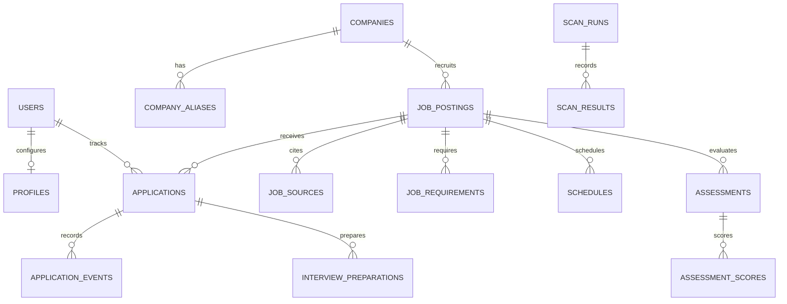

# Phase 1 데이터 계약

Phase 2는 두 번째 마이그레이션으로 지원 의사 이력, 공고 수정 시각, 일정의 선행 관계와 장소·시간 세부 항목을 추가한다. 날짜 미정 일정은 start_date를 NULL로 저장한다. 아래 사전은 Phase 1 마이그레이션 기준이며, 변경된 열의 계약은 `packages/database/migrations/002_workflow.sql`에서 확인한다.

기업 → 모집 회차의 직무 → 지원·일정을 구분한다. 한 기업의 같은 회차에서도 직무코드가 다르면 별도 공고다. 지원 의사만 저장한 행은 초기 전형 `not_submitted`와 비어 있는 제출 시각을 갖는다. 일정의 소속 회차와 실제 지원은 별도 관계다.

### 저장 규칙

- 일정 날짜는 서울 기준 달력 날짜 YYYY-MM-DD, 선택 시각은 HH:mm이다. 시각을 모르면 NULL이며, 하루를 넘기는 기간은 종료일을 함께 보존한다. 감사 시각은 UTC ISO 8601이다.
- 서버가 신규 ID와 초기 버전을 할당한다. 수정·삭제는 조회한 버전을 요구한다. 일반 목록에서 소프트 삭제 행은 제외하고 감사 기록을 보존한다.
- 프로필은 `PUT /api/v1/profile`로 전체 교체한다. 누락된 선택 항목은 제거된다. 직무 우선순위는 순서 있는 목록, 선호지역은 선호값으로 보존한다.
- 이 사전은 마이그레이션을 적용한 SQLite의 카탈로그에서 추출했다. 저장 구조 28개 중 현재 업무 API는 기업, 공고, 일정, 프로필을 제공한다. 외래키·고유 인덱스·검사식의 원문은 `packages/database/migrations/001_foundation.sql`에 있다.

### 주요 관계

### app_settings

인스턴스 설정값과 버전

| 열 | 형식 | 제약 및 기본값 |
|---|---|---|
| key | TEXT | PK 1 · 필수 |
| value_json | TEXT | 필수 |
| version | INTEGER | 필수 · 기본 `1` |

### application_events

전형 상태의 변경 시각·출처·전후 값

| 열 | 형식 | 제약 및 기본값 |
|---|---|---|
| id | TEXT | PK 1 · 필수 |
| application_id | TEXT | 필수 · FK → applications.id |
| previous_stage | TEXT | 선택 |
| next_stage | TEXT | 필수 |
| occurred_at | TEXT | 필수 |
| source | TEXT | 필수 |

### applications

회차별 지원 의사, 실제 전형, 제출 시각

| 열 | 형식 | 제약 및 기본값 |
|---|---|---|
| id | TEXT | PK 1 · 필수 |
| posting_id | TEXT | 필수 · FK → job_postings.id |
| user_id | TEXT | 필수 · FK → users.id |
| intent | TEXT | 필수 |
| stage | TEXT | 필수 · 기본 `'not_submitted'` |
| submitted_at | TEXT | 선택 |
| version | INTEGER | 필수 · 기본 `1` |
| deleted_at | TEXT | 선택 |

### assessment_scores

평가 항목 점수와 근거

| 열 | 형식 | 제약 및 기본값 |
|---|---|---|
| assessment_id | TEXT | PK 1 · 필수 · FK → assessments.id |
| criterion | TEXT | PK 2 · 필수 |
| score | REAL | 필수 |
| rationale | TEXT | 필수 |

### assessments

회차별 평가 방식의 버전과 근거

| 열 | 형식 | 제약 및 기본값 |
|---|---|---|
| id | TEXT | PK 1 · 필수 |
| posting_id | TEXT | 필수 · FK → job_postings.id |
| evaluation_version | TEXT | 필수 |
| evidence | TEXT | 필수 |
| assessed_at | TEXT | 필수 |

### change_logs

인증 주체와 변경 전후 스냅샷

| 열 | 형식 | 제약 및 기본값 |
|---|---|---|
| seq | INTEGER | PK 1 |
| entity | TEXT | 필수 |
| record_id | TEXT | 필수 |
| actor | TEXT | 필수 · FK → users.id |
| before_json | TEXT | 선택 |
| after_json | TEXT | 필수 |
| changed_at | TEXT | 필수 |

### companies

기업의 정규 이름·분류·출처

| 열 | 형식 | 제약 및 기본값 |
|---|---|---|
| id | TEXT | PK 1 · 필수 |
| name | TEXT | 필수 |
| size_class | TEXT | 선택 |
| institution_type | TEXT | 선택 |
| source_url | TEXT | 선택 |
| verified_on | TEXT | 선택 |
| version | INTEGER | 필수 · 기본 `1` |
| deleted_at | TEXT | 선택 |

### company_aliases

기업의 별칭

| 열 | 형식 | 제약 및 기본값 |
|---|---|---|
| alias | TEXT | PK 1 · 필수 |
| company_id | TEXT | 필수 · FK → companies.id |

### documents

문서 버전과 별도 저장소의 객체 키

| 열 | 형식 | 제약 및 기본값 |
|---|---|---|
| id | TEXT | PK 1 · 필수 |
| application_id | TEXT | FK → applications.id |
| kind | TEXT | 필수 |
| version | INTEGER | 필수 |
| object_key | TEXT | 필수 |
| created_at | TEXT | 필수 |

### exclusions

기업 또는 단일 회차에 적용할 제외 규칙

| 열 | 형식 | 제약 및 기본값 |
|---|---|---|
| id | TEXT | PK 1 · 필수 |
| company_id | TEXT | FK → companies.id |
| posting_id | TEXT | FK → job_postings.id |
| rule_id | TEXT | FK → rules.id |
| reason | TEXT | 필수 |

### instance_binding

저장소 생성 시 고정한 인스턴스와 용도

| 열 | 형식 | 제약 및 기본값 |
|---|---|---|
| singleton | INTEGER | PK 1 |
| realm | TEXT | 필수 |
| stage | TEXT | 필수 |

### interview_feedback

면접 질문별 피드백

| 열 | 형식 | 제약 및 기본값 |
|---|---|---|
| id | TEXT | PK 1 · 필수 |
| question_id | TEXT | 필수 · FK → interview_questions.id |
| feedback | TEXT | 필수 |
| created_at | TEXT | 필수 |

### interview_preparations

지원에 연결된 면접 준비 기록

| 열 | 형식 | 제약 및 기본값 |
|---|---|---|
| id | TEXT | PK 1 · 필수 |
| application_id | TEXT | 필수 · FK → applications.id |
| notes | TEXT | 선택 |
| updated_at | TEXT | 필수 |

### interview_questions

준비 기록별 질문과 답변

| 열 | 형식 | 제약 및 기본값 |
|---|---|---|
| id | TEXT | PK 1 · 필수 |
| preparation_id | TEXT | 필수 · FK → interview_preparations.id |
| question | TEXT | 필수 |
| answer | TEXT | 선택 |

### job_postings

모집 회차별 직무·마감·채용 조건

| 열 | 형식 | 제약 및 기본값 |
|---|---|---|
| id | TEXT | PK 1 · 필수 |
| company_id | TEXT | 필수 · FK → companies.id |
| round_key | TEXT | 필수 |
| role_code | TEXT | 필수 |
| title | TEXT | 필수 |
| responsibilities | TEXT | 선택 |
| location | TEXT | 선택 |
| headcount | INTEGER | 선택 |
| compensation | TEXT | 선택 |
| employment_type | TEXT | 선택 |
| deadline_date | TEXT | 선택 |
| deadline_time | TEXT | 선택 |
| review_status | TEXT | 필수 · 기본 `'new'` |
| posting_status | TEXT | 필수 · 기본 `'unverified'` |
| previous_id | TEXT | FK → job_postings.id |
| version | INTEGER | 필수 · 기본 `1` |
| deleted_at | TEXT | 선택 |

### job_requirements

회차별 필수 및 우대 조건

| 열 | 형식 | 제약 및 기본값 |
|---|---|---|
| id | TEXT | PK 1 · 필수 |
| posting_id | TEXT | 필수 · FK → job_postings.id |
| kind | TEXT | 필수 |
| criterion | TEXT | 필수 |

### job_sources

복수 출처·확인일·근거

| 열 | 형식 | 제약 및 기본값 |
|---|---|---|
| id | TEXT | PK 1 · 필수 |
| posting_id | TEXT | 필수 · FK → job_postings.id |
| url | TEXT | 필수 |
| verified_on | TEXT | 선택 |
| evidence | TEXT | 선택 |

### profiles

소유자별 프로필 설정

| 열 | 형식 | 제약 및 기본값 |
|---|---|---|
| user_id | TEXT | PK 1 · 필수 · FK → users.id |
| details | TEXT | 필수 |
| version | INTEGER | 필수 · 기본 `1` |

### rules

규칙 코드별 버전과 적용 여부

| 열 | 형식 | 제약 및 기본값 |
|---|---|---|
| id | TEXT | PK 1 · 필수 |
| code | TEXT | 필수 |
| version | INTEGER | 필수 |
| definition | TEXT | 필수 |
| active | INTEGER | 필수 |

### scan_results

스캔 결과의 대상과 분류

| 열 | 형식 | 제약 및 기본값 |
|---|---|---|
| id | TEXT | PK 1 · 필수 |
| run_id | TEXT | 필수 · FK → scan_runs.id |
| posting_id | TEXT | FK → job_postings.id |
| outcome | TEXT | 필수 |
| evidence | TEXT | 선택 |

### scan_runs

스캔 실행·상태·멱등 키

| 열 | 형식 | 제약 및 기본값 |
|---|---|---|
| id | TEXT | PK 1 · 필수 |
| started_at | TEXT | 필수 |
| ended_at | TEXT | 선택 |
| status | TEXT | 필수 |
| idempotency_key | TEXT | 필수 |

### schedules

개별 전형 일정·기간·조건

| 열 | 형식 | 제약 및 기본값 |
|---|---|---|
| id | TEXT | PK 1 · 필수 |
| posting_id | TEXT | 필수 · FK → job_postings.id |
| kind | TEXT | 필수 |
| title | TEXT | 필수 |
| start_date | TEXT | 필수 |
| end_date | TEXT | 선택 |
| start_time | TEXT | 선택 |
| end_time | TEXT | 선택 |
| location | TEXT | 선택 |
| status | TEXT | 필수 · 기본 `'planned'` |
| condition_note | TEXT | 선택 |
| source_url | TEXT | 선택 |
| verified_on | TEXT | 선택 |
| version | INTEGER | 필수 · 기본 `1` |
| deleted_at | TEXT | 선택 |

### schema_migrations

적용한 마이그레이션 파일과 SHA-256

| 열 | 형식 | 제약 및 기본값 |
|---|---|---|
| name | TEXT | PK 1 |
| sha256 | TEXT | 필수 |

### skills

기술 명칭 목록

| 열 | 형식 | 제약 및 기본값 |
|---|---|---|
| id | TEXT | PK 1 · 필수 |
| name | TEXT | 필수 |

### sync_batches

가져오기 배치 식별·내용 식별값·충돌

| 열 | 형식 | 제약 및 기본값 |
|---|---|---|
| id | TEXT | PK 1 · 필수 |
| idempotency_key | TEXT | 필수 |
| payload_digest | TEXT | 필수 |
| status | TEXT | 필수 |
| conflicts | TEXT | 선택 |

### usage_metrics

실측 지표·단위·측정 시각

| 열 | 형식 | 제약 및 기본값 |
|---|---|---|
| id | TEXT | PK 1 · 필수 |
| metric | TEXT | 필수 |
| value | REAL | 필수 |
| unit | TEXT | 필수 |
| measured_at | TEXT | 필수 |

### user_skills

사용자별 기술 숙련도와 근거

| 열 | 형식 | 제약 및 기본값 |
|---|---|---|
| user_id | TEXT | PK 1 · 필수 · FK → users.id |
| skill_id | TEXT | PK 2 · 필수 · FK → skills.id |
| level | TEXT | 필수 |
| evidence | TEXT | 선택 |

### users

인스턴스 내 사용자 역할

| 열 | 형식 | 제약 및 기본값 |
|---|---|---|
| id | TEXT | PK 1 · 필수 |
| role | TEXT | 필수 |
