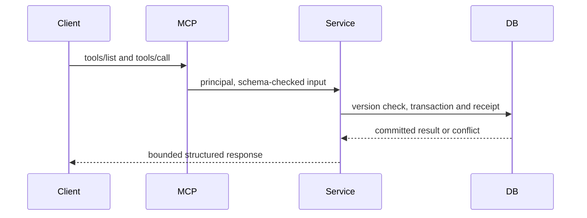

# MCP tool reference

The owner workspace exposes 39 tools. The hosted Demo also retains the three earlier synthetic test-record tools. Reader credentials on the local gateway can discover search_jobs and get_job_details. For complete schemas call tools/list. Every write runs through the authorized service and returns a structured result or a tool error. Reuse a request key only for the same operation and arguments.

| Tool | Action | Required inputs | Purpose |
|---|---|---|---|
| search_jobs | Read / preview | — | Search posting titles, roles and rounds. Results are paginated. |
| preview_work_batch | Read / preview | schemaVersion, items, key | Preview a versioned Work exchange batch and return row decisions. |
| apply_work_batch | Write | schemaVersion, items, key | Apply a reviewed Work batch and return the durable row receipts. |
| confirm_official_deadline | Write | postingId, postingVersion, scheduleId, scheduleVersion, date, source, evidence, verifiedOn, key | Confirm one sourced deadline change on an exact posting and its linked deadline event. |
| get_job_details | Read / preview | id | Read a single posting by exact ID and its source evidence. |
| get_dashboard | Read / preview | — | Return workspace counts and the reporting date. |
| get_schedule | Read / preview | — | Read a page of workspace schedules, with conflicts and status. |
| get_upcoming_events | Read / preview | — | Read active dated schedules in chronological order. |
| check_schedule_conflicts | Read / preview | — | List active schedule conflicts on the stored calendar. |
| get_applications | Read / preview | — | Read a page of application decisions and submission stages. |
| get_user_profile | Read / preview | — | Read the current owner qualification profile. |
| get_recruitment_rules | Read / preview | — | List the active built-in eligibility rule identifiers. |
| get_unreviewed_jobs | Read / preview | — | List postings awaiting review. |
| get_assessment | Read / preview | id | Read latest saved assessment for an exact posting. |
| list_assessments | Read / preview | — | Read a page of saved assessment metadata. |
| evaluate_eligibility | Read / preview | id | Evaluate the current rules against stored posting evidence. |
| compare_jobs | Read / preview | ids | Compare two to five distinct posting IDs and their evidence. |
| get_interview_context | Read / preview | id | Read one application and its interview preparations. |
| analytics | Read / preview | — | Compute descriptive workspace statistics. |
| get_recent_changes | Read / preview | — | Read change metadata after a sequence number. |
| export_changes | Read / preview | — | Read change metadata after a sequence number. |
| export_schedule | Read / preview | — | Export a page of active schedule rows as JSON. |
| export_handover | Read / preview | — | Export summary counts and one page of changes. |
| get_scan_runs | Read / preview | — | Read scan outcomes, failure queue and per-run evidence. |
| check_duplicate | Read / preview | company, posting | Preview identity resolution for one incoming posting without saving. |
| validate_import | Read / preview | items | Dry-run a scan batch and return its item outcomes. |
| import_job_batch | Write | items, key | Receive a bounded discovery batch. Replay the same key and items for retry. |
| record_scan_run | Write | items, key | Receive a bounded discovery batch. Replay the same key and items for retry. |
| retry_scan_run | Write | id, key | Retry one failed run using its stored payload, up to three total attempts. |
| add_job | Write | data, key | Create one validated record. |
| update_job | Write | id, version, data, key | Edit one exact record at its observed version. |
| add_schedule | Write | data, key | Create one validated record. |
| update_schedule | Write | id, version, data, key | Edit one exact record at its observed version. |
| add_application | Write | data, key | Save one explicit application decision. Submission requires confirmation. |
| update_application_status | Write | id, version, data, key | Save one explicit application decision. Submission requires confirmation. |
| save_assessment | Write | id, data, key | Save an assessment at its observed input versions. |
| get_fit_profile | Read | id | Read the current revision of the independent fit ratings. |
| save_fit_profile | Write | id, version, postingVersion, asOf, reason, scores, key | Save five independent fit ratings for an exact posting. |
| save_interview_feedback | Write | id, feedback, key | Append feedback to one existing interview question. |

