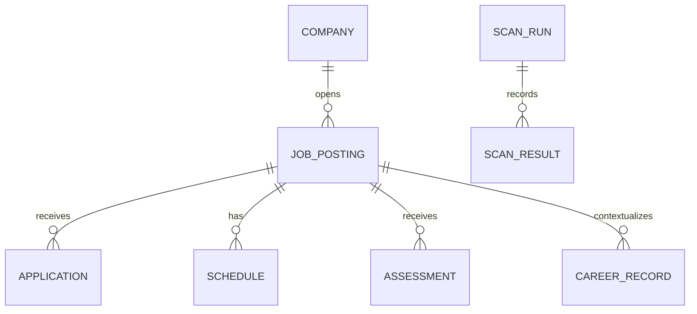

# CareerOps Demo · 포트폴리오 시연

CareerOps는 공고와 모집 회차, 지원 결정, 일정, 판정 근거를 연결한다. 각 로컬 세션은 합성 기업 36개와 공고 72개, 지원 30개, 일정 60개, 평가 24개, 면접 8개, 실행 12개, 저장 규칙 12개로 시작한다. 마감은 실행 시점의 서울 날짜를 기준으로 생성한다.

CareerOps connects recruiting rounds, application decisions, schedules and source evidence. Each local sandbox starts with synthetic data in an isolated SQLite store. The MCP Playground issues real local JSON-RPC calls. Scan inputs are simulated.

```powershell
node scripts/demo.mjs
```

Open the printed loopback URL and paste its session key into the sign-in form. Each launch creates an independent database, port and credential. To repeat a scenario, select Reset to seed in MCP Playground.

| Scenario | Where to try it |
|---|---|
| Register and review | Job Explorer for registration. MCP Playground offers check_duplicate and evaluate_eligibility. |
| Compare | Compare two reviewed technical roles and inspect criterion coverage. |
| Reject | Use an application in progress. Confirm the exact round in the command palette, then check schedule and activity history. |
| Plan and export | Open the schedule, filter dated or conditional records, then export Markdown or ICS. |
| Receive a scan | Load the synthetic scan example in MCP Playground, run it and inspect Activity Log after refreshing. |
| Exercise a tool | Select get_dashboard for a read or add_schedule for a versioned workflow. Inspect the structured response. |
| Review local work | Open Analytics for recorded local evaluations, cache hits and intake counts. |



Browser ES modules call a Node HTTP service with instance-bound bearer authentication. SQLite stores records and audit events. Deterministic code performs rules, version checks, idempotent writes and statistics. An AI client can use the MCP contract for evidence review and tool selection. No paid model is wired into the demo. The metrics show local observations; a token or cost baseline requires separately instrumented AI calls. The Sites Worker is a smaller integration test with isolated synthetic records. The full interactive portfolio sandbox runs on loopback.

Project direction and workflow requirements came from the project owner. Codex implemented the prototype, fixture generator and automated verification. Performance figures in the test notes describe the measured execution environment. [Data contract](DATA_CONTRACT.md) · [MCP contract](GATEWAY.md) · [Exchange and recovery](EXCHANGE.md)
